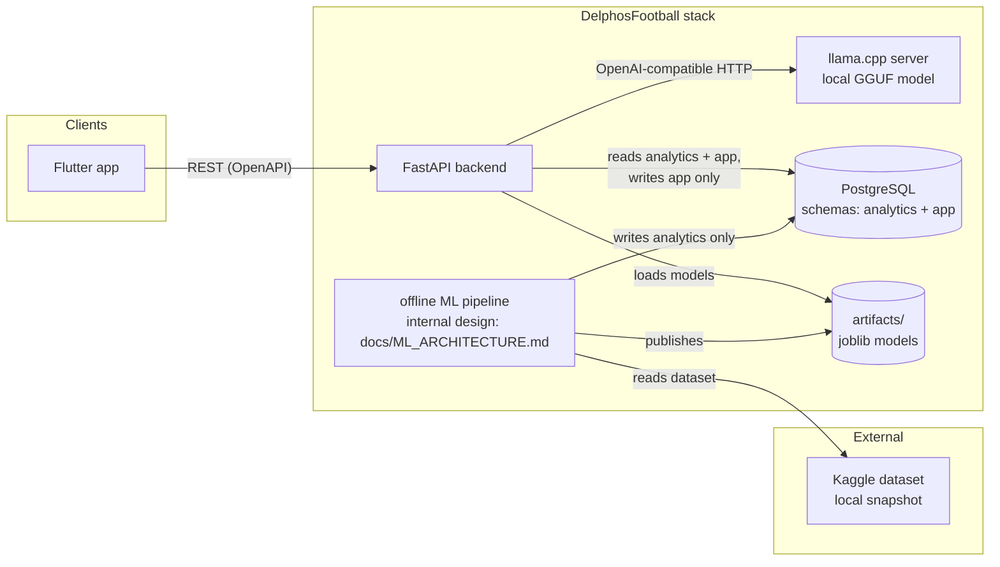
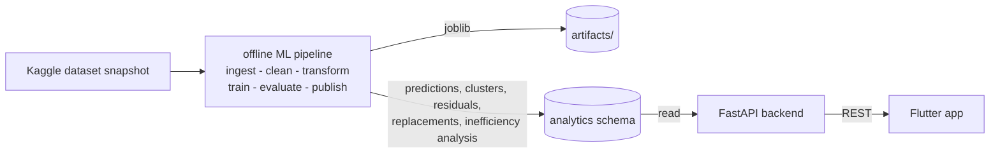
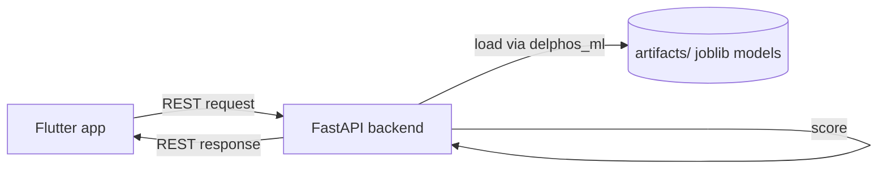
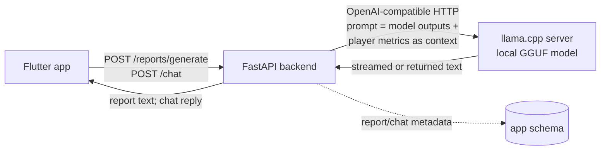

# DelphosFootball Software Architecture

## Table of contents

1. [Purpose and scope](#1-purpose-and-scope)
2. [System context](#2-system-context)
3. [Architecture overview](#3-architecture-overview)
4. [Components](#4-components)
   - 4.1 [Flutter frontend](#41-flutter-frontend)
   - 4.2 [FastAPI backend](#42-fastapi-backend)
   - 4.3 [delphos_ml shared package](#43-delphos_ml-shared-package)
   - 4.4 [Offline ML pipeline](#44-offline-ml-pipeline)
   - 4.5 [Jupyter notebooks](#45-jupyter-notebooks)
   - 4.6 [LLM inference service](#46-llm-inference-service)
   - 4.7 [PostgreSQL](#47-postgresql)
5. [Data flow](#5-data-flow)
   - 5.1 [Batch flow](#51-batch-flow)
   - 5.2 [Live inference flow](#52-live-inference-flow)
   - 5.3 [LLM report and chat flow](#53-llm-report-and-chat-flow)
6. [API surface sketch](#6-api-surface-sketch)
7. [Data storage design](#7-data-storage-design)
8. [Deployment topology](#8-deployment-topology)
9. [Cross-cutting concerns](#9-cross-cutting-concerns)
10. [Decisions and tradeoffs](#10-decisions-and-tradeoffs)
11. [Future work](#11-future-work)
12. [See also](#12-see-also)

---

## 1. Purpose and scope

This document describes the software architecture of DelphosFootball: the system that identifies economically undervalued football players from the "Football Data from Transfermarkt" Kaggle dataset, as scoped in [docs/CONTEXT.md](CONTEXT.md). It exists so that a new engineer can understand the system's components, their contracts, and the reasoning behind the major technology choices without reading the code first.

The audience is an experienced engineer joining the project, plus the two-person course team.

**Out of scope:**

- **ML algorithm design.** The modeling methodology (K-Means clustering, linear and polynomial regression, Random Forest classification; see docs/CONTEXT.md sections 4-6) is deliberately deferred. This document treats the ML pipeline as a black-box "offline pipeline" component. Its internal design — feature engineering, model selection, evaluation strategy — will be documented in `docs/ML_ARCHITECTURE.md`, which exists as a skeleton carrying the definition checklist for these decisions; its content is still pending.
- **Feature roadmap.** Product backlog and delivery schedule live elsewhere; see [Future work](#11-future-work).

## 2. System context

DelphosFootball is an internal scouting tool. Its primary users are:

- **Club analysts / directors** — interact with the Flutter app to search players, inspect valuations and undervaluation findings, browse player archetypes, review generated scouting reports, and chat with the LLM about results.
- **The data-mining team** — operate the offline pipeline and notebooks, and evaluate the system as a course deliverable (the grader evaluates both the Flutter app and the Jupyter notebook mirror of the algorithms; see [Jupyter notebooks](#45-jupyter-notebooks)).

External systems:

| External system | Relationship |
| --- | --- |
| Kaggle "Football Data from Transfermarkt" dataset | Source of truth for raw data. Downloaded manually; the pipeline's ingest stage reads the local snapshot. No live API. |
| ggml-org/llama.cpp project | Source of the llama.cpp server container image used for local LLM inference. |
| Quantized GGUF model weights | Downloaded manually from a public GGUF repository (the specific repository and quant file will be recorded here when provisioned) into `llms/models/`; the running system never fetches model weights at runtime. |

Provisioning assumptions: model weights are provisioned manually — an engineer downloads the chosen GGUF file into `llms/models/` before the stack starts, and the `inference-chat` service mounts that directory. The runtime intent from docs/CONTEXT.md ("Windows environments") is satisfied either through Docker Desktop with WSL2 GPU passthrough (CUDA variant of the llama.cpp image) or by accepting CPU-only inference latency where no GPU is available; nothing in the architecture depends on which.

A headline product claim from docs/CONTEXT.md ("EXTRAS") is that scouting data never leaves the club's servers. The architecture honors this because all inference runs through a local llama.cpp process; no third-party LLM API is called.

## 3. Architecture overview

The system is a small containerized stack: a Flutter frontend, a FastAPI backend, one PostgreSQL instance with two schemas, one local LLM server, and an offline batch pipeline that shares a Python package with the backend. Jupyter notebooks mirror the pipeline's algorithms as a first-class deliverable.

The ML pipeline is shown as a black box here by design. Its internals are deferred to `docs/ML_ARCHITECTURE.md`, which now exists as a skeleton carrying the definition checklist for the pending decisions.



Both the backend and the pipeline import the same shared Python package, `delphos_ml` (not drawn above for clarity). See [Components](#4-components) for each container's responsibility and contracts.

## 4. Components

### 4.1 Flutter frontend

- **Responsibility:** The user experience. Mobile-first Flutter app for searching players, viewing valuations and undervaluation findings, exploring clusters/archetypes, browsing scouting reports, and chatting with the LLM. The UX is a deliberate product feature, not a demo shell.
- **Technology:** Flutter (Dart), with the Flutter SDK pinned to an exact version in `pubspec.yaml` and `pubspec.lock` committed; all pins date from project kickoff and are bumped only via explicit dependency-bump commits. Targets mobile form factors first; a web build is acceptable as the demo vehicle.
- **Interfaces/contracts:** Consumes the backend's REST API. The OpenAPI spec that FastAPI generates is the contract of record; the Flutter HTTP client is generated from (or written against) that spec. Talks only to the backend — the frontend never reaches the database, pipeline, or LLM server directly.

### 4.2 FastAPI backend

- **Responsibility:** Serves all use cases to the frontend over REST: player search and valuation results, undervaluation findings, replacement recommendations served read-only from the pipeline-published `replacements` table (the "at least 3 profitable replacements per elite asset" expectation from docs/CONTEXT.md section 5 — see [Data flow](#51-batch-flow)), live "what-if" scoring of a synthetic player profile against the active model artifacts, the cluster/archetype explorer, scouting report retrieval and generation triggers, and LLM chat relay. It enforces the LLM call limits (timeouts, concurrency, context budget — defined in `docs/ML_ARCHITECTURE.md`) and degrades the LLM-dependent routes when the inference service is unavailable (see [Cross-cutting concerns](#9-cross-cutting-concerns)).
- **Technology:** FastAPI on uvicorn (Python, exact versions pinned in the lockfiles shared with `ml/` — see [Cross-cutting concerns](#9-cross-cutting-concerns)), with Pydantic schemas shared with `delphos_ml` types. Organized as routers/services/schemas per feature, following the layout the team used in hyperwrite-ai.
- **Interfaces/contracts:**
  - **In:** REST from the Flutter client, described by the generated OpenAPI spec (see [API surface sketch](#6-api-surface-sketch)).
  - **Out:** reads the `analytics` schema and reads/writes the `app` schema in PostgreSQL through the API database role, resolving the active model run through `analytics.model_runs` (see [Artifact contract](#43-delphos_ml-shared-package)); loads joblib model artifacts from `artifacts/` via the `delphos_ml` package for live inference (`POST /players/what-if`); calls the llama.cpp server over OpenAI-compatible HTTP for report generation and chat, passing model outputs and player metrics as context within the limits defined in `docs/ML_ARCHITECTURE.md`.

### 4.3 delphos_ml shared package

- **Responsibility:** The single Python library both the backend and the pipeline import. It contains data schemas/types (shared Pydantic models), model-loading code, and the scoring functions used for inference. Batch training and batch scoring live behind the pipeline's CLI; interactive scoring is exposed as ordinary importable functions.
- **Technology:** Python package living in `ml/` (see [Repository layout](#repository-layout)). Depends on scikit-learn, pandas, Pydantic (exact versions pinned as of project kickoff in the lockfiles shared with `backend/` — see [Cross-cutting concerns](#9-cross-cutting-concerns)). Model artifacts are serialized with joblib.
- **Interfaces/contracts:** The backend imports it to load trained joblib artifacts from `artifacts/` and score on demand (live inference, e.g. "what-if" re-scoring of a hypothetical player). The pipeline imports it for batch training and batch scoring. This dual-mode requirement — batch inference by the pipeline and live inference by the API from the same artifacts — is a core architectural constraint, which is why the package is shared rather than duplicated.

**Artifact contract** — the publish/load boundary this package enforces:

- Each publish writes `artifacts/<model_run_id>/` containing the trained model, the preprocessor, and a `manifest.json` with the ordered feature names, the scikit-learn and `delphos_ml` versions, the dataset snapshot hash, and a training-config reference. The exact manifest and training-config fields are defined in `docs/ML_ARCHITECTURE.md`.
- Exactly one `model_runs` row has status `active`; both the publish stage and the backend resolve the "current model" through it (see [Publish/activation protocol](#44-offline-ml-pipeline)).
- `delphos_ml.load_model()` refuses to load an artifact whose recorded scikit-learn version differs from the installed one.
- `backend/` and `ml/` share one dependency lockfile so joblib unpickling cannot drift between the pipeline that wrote the artifacts and the API that reads them.

### 4.4 Offline ML pipeline

> Internal design (algorithms, features, evaluation) is deferred to `docs/ML_ARCHITECTURE.md` (skeleton exists; its definition checklist carries the pending decisions). This section covers only its place in the software architecture.

- **Responsibility:** Batch ingestion and publishing. Runs the stages ingest → clean → transform → train → evaluate → publish, producing trained models and publishing predictions, cluster assignments, valuation residuals, replacement candidates, and an inefficiency analysis into the database.
- **Technology:** Python with scikit-learn and pandas, orchestrated as CLI stages (one command per stage plus an "all" runner). It is a batch pipeline, not a long-running service: it runs manually, on demand, or on a schedule via Docker (the `pipeline` compose profile). It is never on the request path.
- **Interfaces/contracts:**
  - **In:** reads a local snapshot of the Kaggle dataset (the ingest stage's input path is configured via env).
  - **Out:** writes trained model artifacts (joblib) into `artifacts/<model_run_id>/` per the [Artifact contract](#43-delphos_ml-shared-package); publishes predictions, cluster assignments, valuation residuals, replacement candidates, and the inefficiency analysis into the `analytics` schema through the pipeline database role (writes `analytics` only). Optional Parquet exports of published results for analysis outside the database.
  - The `evaluate` stage produces an inefficiency-analysis output (`inefficiency_analysis`), published alongside predictions. Minimal acceptance for this output: at least one hypothesis test with a reported statistic and significance over transfer-fee vs predicted-value residuals, presented in the notebooks (see [Jupyter notebooks](#45-jupyter-notebooks)) and summarized in the app. Which tests and which statistics are defined in `docs/ML_ARCHITECTURE.md`.

**Publish/activation protocol.** `publish` is transactional from the API's point of view:

1. Write the new artifacts to a fresh `artifacts/<model_run_id>/` directory first ([Artifact contract](#43-delphos_ml-shared-package)).
2. Bulk-load all result rows — predictions, clusters, replacements, inefficiency analysis — in a single database transaction, with `model_run_id` on every row.
3. In that same transaction, flip this run's `model_runs` row to `active` — a one-row pointer update; the previous run's rows stay intact.

The API filters its reads on the active run and includes the `model_run_id` in responses that carry model-derived values. A crash before step 3 leaves the prior run's artifacts, rows, and active pointer untouched, so a crashed run never corrupts what the API serves.

### 4.5 Jupyter notebooks

- **Responsibility:** A notebook-per-stage mirror of the pipeline's algorithms (cleaning, transformation, clustering, regressions, classification), including the statistical demonstration of market inefficiency: at least one hypothesis test with reported statistic and significance over transfer-fee vs predicted-value residuals (the test selection is defined in `docs/ML_ARCHITECTURE.md`). Notebooks are a first-class deliverable, not an afterthought: the grader evaluates a Jupyter mirror of the ML algorithms alongside the app.
- **Technology:** Jupyter (pinned in the same lockfile family as the other Python components), importing `delphos_ml` where practical so the notebooks and pipeline share code rather than drift.
- **Interfaces/contracts:** Reads the same dataset snapshot as the pipeline; writes nothing to the database. Notebooks are exploratory/graded artifacts and do not run in the deployed stack.

### 4.6 LLM inference service

- **Responsibility:** The only separate AI process. Serves two features: (a) AI-generated natural-language scouting reports that translate model results into executive prose, and (b) an interactive chat where the user converses about scouting results. For chat, the backend relays the conversation and includes model outputs and player metrics as context.
- **Technology:** llama.cpp server (ggml-org/llama.cpp server image, CUDA variant with CPU fallback) serving a quantized Qwen GGUF model from a mounted `llms/models/` directory; the specific model and quant are defined in `docs/ML_ARCHITECTURE.md`. Exposes an OpenAI-compatible HTTP API.
- **Interfaces/contracts:** In: OpenAI-compatible HTTP (`/v1/chat/completions` and related endpoints) from the backend only — clients never call it directly. This service is the system's sole LLM provider: no external LLM API is called anywhere in the system. Out: none.

LLM call parameters — timeouts, concurrency limits, context budget and assembly rules, and model/quant selection — are defined in `docs/ML_ARCHITECTURE.md`. The backend enforces those limits on every call and degrades the LLM-dependent routes when this service is unavailable (see [Cross-cutting concerns](#9-cross-cutting-concerns)).

### 4.7 PostgreSQL

- **Responsibility:** The single datastore for both pipeline outputs and application data.
- **Technology:** `postgres:16` (plain image; pgvector is not required by the current scope — see [Data storage design](#7-data-storage-design) and [Future work](#11-future-work)). One instance, two schemas (`analytics`, `app`), access separated by database roles.
- **Interfaces/contracts:** The pipeline writes `analytics` only (pipeline role). The backend reads both schemas and writes `app` only (API role). No other component touches the database. See [Data storage design](#7-data-storage-design) for details.

### Repository layout

The monorepo layout below is the convention of record. It follows the team's previous project (hyperwrite-ai) where applicable.

```
backend/       # FastAPI application (routers/services/schemas per feature, as in hyperwrite-ai)
backend/tests/ # pytest unit tests for the API layer
frontend/      # Flutter app (Dart)
ml/            # delphos_ml shared package + pipeline CLI stages
ml/tests/      # pytest unit tests for delphos_ml load/score paths
migrations/    # Alembic config; one migration head per schema (analytics, app)
notebooks/     # Jupyter mirror of ML algorithms (grader deliverable)
llms/models/   # GGUF model files (gitignored)
artifacts/     # trained model artifacts (gitignored — see below)
docs/          # CONTEXT.md + ML_ARCHITECTURE.md
docker-compose.yml
```

`artifacts/` is **gitignored**, not Git LFS. Artifacts are fully regenerable by running the pipeline, and reproducibility is handled by pinning dependencies and recording the dataset snapshot and training configuration alongside each run (see [Cross-cutting concerns](#9-cross-cutting-concerns)). Git LFS would add tooling overhead for a course project without buying reproducibility we do not already have.

`docker-compose.yml` sits at the repo root, which differs from hyperwrite-ai's `backend/`-local placement. The reason: this stack spans backend, LLM inference, database, and pipeline — none of which is subordinate to `backend/` — so the single compose file (one per stack, per hyperwrite-ai convention) belongs at the root.

Conventions adopted from hyperwrite-ai: one `docker-compose.yml` per stack; `.env` gitignored with `.env.example` committed; environment variables for all configuration (CORS origins, DB URL, LLM endpoint and model); Conventional Commits; branch naming `type/part-of-project/what-you-are-doing` (e.g. `feat/backend/player-search`).

## 5. Data flow

### 5.1 Batch flow

The pipeline publishes results; the API serves them; the frontend displays them. This is the primary path for valuations, undervaluation findings, cluster assignments, and replacement recommendations. Replacement recommendations are computed by the pipeline at publish time, not by the API on request: the backend serves the published `replacements` rows read-only through `GET /players/{id}/replacements`. The endpoint returns at least 3 candidates only when 3+ qualifying candidates exist; otherwise it returns fewer, with an explicit "no qualifying replacement" reason — results are never padded. The "elite asset" definition and the athletic-equivalence/similarity metric behind candidate ranking are defined in `docs/ML_ARCHITECTURE.md`.



### 5.2 Live inference flow

The backend scores on demand using the published artifacts, for interactive use cases such as re-scoring a hypothetical ("what-if") player profile. This path is exposed as `POST /players/what-if`: it accepts a synthetic player profile and returns the live-computed fair value and undervaluation flag from the loaded joblib artifacts via `delphos_ml`, with the `model_run_id` of the artifacts used. The what-if input schema and the batch-vs-live equivalence guarantee are defined in `docs/ML_ARCHITECTURE.md`.



### 5.3 LLM report and chat flow

The backend assembles context (model outputs, player metrics) and calls the llama.cpp server; the response is returned or streamed to the client.



Report and chat metadata (when a report or message was requested and which `model_run_id`/model version produced it) is persisted in the `app` schema; the generated text flows through the API to the client. v1 records a single implicit actor: report and chat rows either omit actor columns or carry one shared actor, and `shortlists` is one shared list. Identity columns arrive with the deferred authentication work ([Future work](#11-future-work)).

## 6. API surface sketch

Endpoint groups only — the generated OpenAPI spec is the contract of record. Sketch, not a full spec:

| Endpoint group | Description |
| --- | --- |
| `GET /players` | Search/list players with filters (name, position, cluster, valuation status). |
| `GET /players/{id}` | Full player profile with performance metrics. |
| `GET /players/{id}/valuation` | Predicted fair value, market value, and the residual/undervaluation flag; carries the `model_run_id` that produced the prediction. |
| `POST /players/what-if` | Accepts a synthetic player profile; returns the live-computed fair value and undervaluation flag from the active model artifacts via `delphos_ml`, carrying the `model_run_id` used. |
| `GET /players/{id}/replacements` | Replacement candidates from the pipeline-published `replacements` table: ranked by similarity and cost, at least 3 only when 3+ qualifying candidates exist; otherwise fewer, with an explicit "no qualifying replacement" reason — never padded. Carries the `model_run_id`. |
| `GET /clusters` | Cluster/archetype explorer: list archetypes and their member players. |
| `POST /reports/generate` | Trigger an AI-generated natural-language scouting report for a player or finding; returns or streams the text. |
| `GET /reports` / `GET /reports/{id}` | Retrieve previously generated reports. |
| `POST /chat` | Interactive chat about scouting results; the backend relays to the LLM with model-output context and streams replies. |
| `GET /health/live` | Liveness probe: the process is up. Used by compose healthchecks. |
| `GET /health/ready` | Readiness probe: database reachable and the active artifact loadable via `delphos_ml`. The LLM service is deliberately excluded so an LLM outage never fails readiness. |

## 7. Data storage design

One PostgreSQL instance holds two schemas with separate owners. Access separation is enforced by database roles, not by convention:

| | `analytics` | `app` |
| --- | --- | --- |
| Owner | Pipeline | Backend |
| Written by | Pipeline role only | API role only |
| Read by | API role | API role |
| Contents | Staging and curated player data, engineered features, predictions, cluster assignments, valuation residuals, replacement candidates, inefficiency analysis, model/run metadata | User data: saved shortlists, scouting report records, chat session/message metadata |

Illustrative tables (design intent, not exhaustive): `analytics` holds raw/staging tables mirroring the dataset, curated feature tables, a `predictions` table (fair value, residual, undervaluation flag, keyed by player and `model_run_id`), a `clusters` table, a `replacements` table (computed at publish, keyed by target player and `model_run_id`, holding ranked candidates with similarity score and cost data, limit 3 per target), the inefficiency-analysis output, and a `model_runs` table recording each publish. `app` holds `shortlists`, `reports` (text plus the `model_run_id` that produced them), and `chat_sessions` / `chat_messages`.

Schema changes are managed by Alembic with one migration head per schema (`analytics`, `app`); each head is applied by that schema's owning role — pipeline role for `analytics`, API role for `app`. The role/schema bootstrap SQL implied by ADR-002 is committed as migration `0001`, so role enforcement lives in reviewable migrations rather than manual setup. Migrations run as the one-shot `migrate` compose step before the backend starts (see [Deployment topology](#8-deployment-topology)).

The two-database-server alternative was considered and rejected: it adds operational overhead (two backups, two upgrades, cross-DB queries needed for reports) without buying real isolation, since one course project controls both roles. Role separation within one instance is sufficient. See [Decisions and tradeoffs](#10-decisions-and-tradeoffs).

The base image is plain `postgres:16`; pgvector is not adopted because no current feature requires vector search. If semantic retrieval over reports is ever added, switching to the pgvector-enabled image of the same major version is a drop-in change ([Future work](#11-future-work)).

## 8. Deployment topology

Everything runs under Docker Compose via a single root `docker-compose.yml` (scalable and reproducible per the team's decision). Named network, named volumes for DB data, model files, and artifacts; healthchecks with `depends_on: condition: service_healthy` throughout, plus a one-shot `migrate` step that the backend waits on (`service_completed_successfully`).

| Service | Image / build | Ports | Volumes | Depends on |
| --- | --- | --- | --- | --- |
| `frontend` | Flutter web build (built in CI or a build stage; served as static files) | `80` (HTTP) | — | `backend` (service_healthy) |
| `backend` | FastAPI app (`backend/`, uvicorn) | `8000` | `artifacts` (read-only) | `db` (service_healthy), `migrate` (service_completed_successfully) |
| `db` | `postgres:16` | `5432` internal only; exposed in dev for tooling | `pgdata` named volume | — |
| `migrate` | Alembic migrations (`migrations/`; one-shot, exits when done) | none | — | `db` (service_healthy) |
| `inference-chat` | `ggml-org/llama.cpp` server image (CUDA variant; CPU fallback) | `8080` internal only | `llms-models` named volume (GGUF files from `llms/models/`) | — |
| `pipeline` | ML pipeline (`ml/`, compose profile `pipeline`) | none | `artifacts` (read-write), dataset mount (read-only) | `db` (service_healthy) |

Notes:

- `pipeline` is gated behind the compose profile so it never starts with the stack; it is invoked as `docker compose --profile pipeline run pipeline <stage>` (or on a schedule outside the always-on services).
- `migrate` runs both Alembic heads (one per schema) as their owning database roles and exits; the backend starts only after it succeeds, so schema migrations are applied before any request is served.
- The backend deliberately does not depend on `inference-chat`. An LLM outage degrades only `/reports/*` and `/chat`, which return a documented "LLM unavailable" problem response; every other route serves normally.
- The `inference-chat` healthcheck verifies that the model is actually loaded (a server-side model check), not merely that the process is listening.
- All configuration comes from `.env` (gitignored; `.env.example` committed): DB URL per role, CORS origins for the Flutter client, LLM endpoint and model name, dataset path.
- The LLM service loads its GGUF model from the mounted models directory; the model file itself is not baked into the image.

**Dev vs prod.** In development, `backend` runs uvicorn with reload, `frontend` runs via `flutter run` against the compose backend, the `db` port may be exposed for local tooling, and the LLM service may run on the CPU variant. In production-shaped deployments, the frontend is a static build, no dev reloads, the DB and LLM ports are internal-only, and the CUDA variant of the llama.cpp image is used where a GPU exists (the image falls back to CPU otherwise). Both modes use the same compose file; differences are driven by `.env` and profiles, not by divergent files.

## 9. Cross-cutting concerns

- **Configuration and secrets.** All configuration is environment variables read from `.env`, which is gitignored; `.env.example` documents every key. This includes DB URLs (one per role), CORS origins for the Flutter client, and the LLM endpoint/model.
- **Reproducibility of model artifacts.** `artifacts/` is gitignored, so reproducibility rests on three things: pinned dependency versions (Python lockfiles per component with one shared constraint set between `backend/` and `ml/` — required by the [Artifact contract](#43-delphos_ml-shared-package) so joblib unpickling cannot drift; the Flutter SDK pinned in `pubspec.yaml` with `pubspec.lock` committed; all pins date from project kickoff and are bumped only via explicit dependency-bump commits), a recorded dataset snapshot (source and hash noted at ingest), and training configuration persisted with each run in `analytics.model_runs`. Anyone can re-run the pipeline and obtain equivalent artifacts.
- **Versioning of published results.** Every published row carries the `model_run_id` that produced it, and reports record the model version used. Exactly one run is `active` at a time; the API reads only the active run and includes the `model_run_id` in responses that carry model-derived values ([Publish/activation protocol](#44-offline-ml-pipeline)). Re-publishing a new model does not silently rewrite historical results already surfaced to users.
- **Error handling at service boundaries.** The backend is the only component that talks to clients, and it translates failures at its boundaries into RFC 9457 problem responses (`application/problem+json` with `type`, `title`, `status`, `detail`, and `trace_id`), defined once as a shared Pydantic model behind a global exception handler. Expected problem types, by endpoint group: *missing artifact* and *stale artifact* (any model-derived read and `/players/what-if`), *LLM unavailable* (`/reports/*` and `/chat` — the rest of the API keeps working during an LLM outage), *mid-stream failure* (streamed report/chat responses, after the 200 headers were already sent), and *not found* (`/players/{id}` and other id lookups). The pipeline fails fast per stage and leaves the previously published results in place; `publish` is the last stage and flips the active pointer only in its final transaction ([Publish/activation protocol](#44-offline-ml-pipeline)), so a crashed run does not corrupt what the API serves.
- **Testing.** v1 scope is unit tests with pytest: fixtures for artifact loading and parametrized scoring cases, covering the `delphos_ml` load/score paths (`ml/tests/`) and the API route logic (`backend/tests/`). The golden batch-vs-live equivalence check, contract tests, OpenAPI drift checks, and CI are explicitly out of v1 scope — listed in [Future work](#11-future-work), not as v1 commitments.
- **CORS for the Flutter client.** The Flutter app runs as web on a different origin than the API. Allowed origins are configured via an env var consumed by FastAPI's CORS middleware; native mobile builds are unaffected by CORS but use the same API base URL configuration.

## 10. Decisions and tradeoffs

Short ADR-style records. All decisions below are settled; they are recorded here for context, not for revisiting.

### ADR-001: FastAPI (Python) over Go for the backend

- **Context:** The backend must serve REST to the Flutter client and perform live inference from scikit-learn artifacts.
- **Decision:** FastAPI on Python.
- **Alternatives:** Go (rejected), Django (heavier than needed).
- **Consequences:** The backend imports `delphos_ml` directly and reuses Pydantic types across ML and API code; one language across backend and ML; OpenAPI documentation is generated for free and becomes the Flutter client's contract. The tradeoff is runtime performance versus Go, which does not matter at this scale.

### ADR-002: One Postgres instance with two schemas over two databases

- **Context:** Pipeline-owned analytics data and backend-owned app data both need storage with separated write access.
- **Decision:** One PostgreSQL instance, `analytics` and `app` schemas, separation enforced by two database roles (pipeline writes `analytics` only; API reads both and writes `app` only).
- **Alternatives:** Two database servers (rejected: operational overhead — separate backups, upgrades, connection pools — without additional meaningful isolation for a single-team system; cross-database joins for report generation would become awkward).
- **Consequences:** One backup, one upgrade path, and the pipeline/API contract is expressed entirely in the `analytics` schema. Access separation is only as strong as role enforcement; the bootstrap SQL that creates the roles and schemas is committed as Alembic migration `0001`, so enforcement is applied from reviewable migrations rather than manual setup.

### ADR-003: Offline batch pipeline + shared package over a tabular-inference microservice

- **Context:** Valuations, clusters, and residuals could be precomputed by a long-running inference service or by batch runs.
- **Decision:** A batch pipeline publishes results to the database and model artifacts to `artifacts/`; the backend imports the shared `delphos_ml` package for the interactive "what-if" cases that cannot be precomputed.
- **Alternatives:** A separate always-on inference microservice (rejected: another deployable and network hop for a workload that is fundamentally batch-shaped; the dataset updates on the order of the Kaggle snapshot, not per-request).
- **Consequences:** The common query path is a database read (fast, simple). Interactive scoring shares one code path (`delphos_ml`) with batch training, eliminating train/serve skew. The cost is that precomputed results refresh only when the pipeline runs, which matches the data's update cadence.

### ADR-004: Local llama.cpp (GGUF) as the sole LLM provider

- **Context:** Scouting data is confidential, and the "EXTRAS" section of docs/CONTEXT.md makes privacy a product claim.
- **Decision:** A local llama.cpp server with a quantized Qwen GGUF model is the system's only LLM provider; no hosted or external API is called at any point.
- **Alternatives:** Hosted API only (rejected: breaks the "data never leaves the club's servers" claim and adds a third-party dependency); a hosted adapter behind a common interface, e.g. Gemini (rejected: even behind a common adapter interface it reintroduces egress, API keys, and a second provider path that undermines the privacy claim the product leads with; the team confirmed llama.cpp-only).
- **Consequences:** The privacy claim is total — all inference runs on the club's hardware. Model quality and updates depend entirely on the locally chosen GGUF model. No API keys or LLM egress to manage. This decision deliberately narrows the Gemini option docs/CONTEXT.md originally allowed.

### ADR-005: Flutter over Streamlit or React

- **Context:** The frontend is a graded deliverable and a stated product feature; it must present search, valuations, clusters, reports, and chat.
- **Decision:** Flutter, mobile-first.
- **Alternatives:** Streamlit (rejected: fastest to build but reads as a demo shell, contrary to the product intent, and constrains the UX); React (rejected: viable, but Flutter gives one codebase for mobile-first targets and a native-feel UX that the team wants to showcase).
- **Consequences:** The team commits to Dart and Flutter tooling; in return the app is a genuine mobile-first product surface rather than a notebook front-end.

### ADR-006: Docker Compose as the deployment unit

- **Context:** The system spans frontend, backend, database, LLM inference, and an offline pipeline; the team wants it scalable and reproducible.
- **Decision:** One root `docker-compose.yml` runs the whole stack; the pipeline runs under a compose profile.
- **Alternatives:** Kubernetes (rejected: operational overkill for a course project); ad-hoc local installs (rejected: not reproducible across the team's machines and the grader's).
- **Consequences:** `docker compose up` reproduces the full stack anywhere with Docker; one file per stack stays true to the hyperwrite-ai convention. Scaling beyond one host would require moving to an orchestrator, which is out of scope.

## 11. Future work

- **`docs/ML_ARCHITECTURE.md`** — the ML algorithm architecture. The file now exists as a skeleton carrying the definition checklist; its content is still pending. Its scope includes the K-Means specifics, regression/classification design, the evaluation and cross-validation plan, the statistical inefficiency demonstration (which hypothesis test(s), reported statistic, and significance over transfer-fee vs predicted-value residuals the pipeline `evaluate` stage and the notebooks must deliver — the acceptance obligation stated in [Components](#4-components) is not deferred), the "elite asset" and athletic-equivalence definitions behind replacements, the LLM call parameters, and the exact publish-output row schemas.
- **Testing beyond unit scope** — the golden batch-vs-live equivalence check, API contract tests, OpenAPI drift checks, and CI (including a CI build of the Flutter frontend) are explicitly out of v1; v1 covers unit tests with pytest only ([Cross-cutting concerns](#9-cross-cutting-concerns)).
- **Resource ceilings and retention policy** — per-user rate limits, request size caps, and retention/pruning policy for reports, chat messages, and published analytics rows.
- **Logging and metrics design** — structured logging format, log shipping, and the metrics/observability stack.
- **Dart client generation mechanism** — whether the Flutter HTTP client is generated from the OpenAPI spec or hand-written against it (the OpenAPI spec is the contract of record either way).
- **Feature roadmap** — product backlog and course schedule are not architecture; they will live in project-management artifacts, not here.
- **Authentication and multi-user support** — the current design is single-team with no auth layer; add it if the tool is ever shared beyond the club.
- **pgvector / semantic retrieval** — if chat gains retrieval over historical reports, switch `db` to the pgvector-enabled Postgres image (same major version, drop-in).
- **Artifact distribution via Git LFS** — if artifacts ever need to be versioned in-repo instead of regenerated, revisit the gitignored-`artifacts/` decision.

## 12. See also

- [docs/CONTEXT.md](CONTEXT.md) — project charter: objectives, KDD strategy, modeling methodology, expectations.
- `docs/ML_ARCHITECTURE.md` — ML algorithm architecture; exists as a skeleton carrying the definition checklist (content pending).
