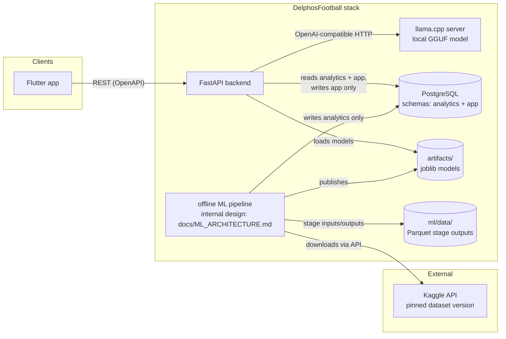
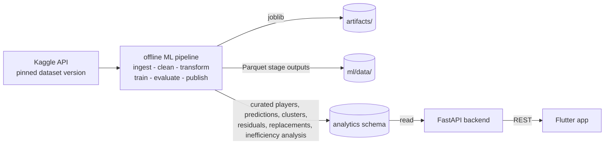
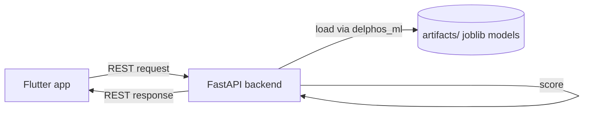
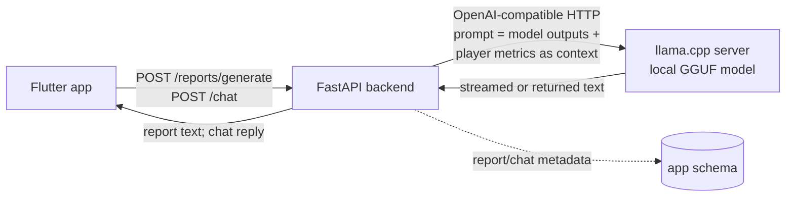

# DelphosFootball Software Architecture

## Table of contents

1. [Purpose and scope](#1-purpose-and-scope)
2. [System context](#2-system-context)
3. [Architecture overview](#3-architecture-overview)
4. [Components](#4-components)
   - 4.1 [Flutter frontend](#41-flutter-frontend)
   - 4.2 [FastAPI backend](#42-fastapi-backend)
   - 4.3 [delphos_ml shared package](#43-delphos_ml-shared-package)
   - 4.4 [Offline ML pipeline](#44-offline-ml-pipeline)
   - 4.5 [Analysis scripts](#45-analysis-scripts)
   - 4.6 [LLM inference service](#46-llm-inference-service)
   - 4.7 [PostgreSQL](#47-postgresql)
5. [Data flow](#5-data-flow)
   - 5.1 [Batch flow](#51-batch-flow)
   - 5.2 [Live inference flow](#52-live-inference-flow)
   - 5.3 [LLM report and chat flow](#53-llm-report-and-chat-flow)
6. [API surface sketch](#6-api-surface-sketch)
7. [Data storage design](#7-data-storage-design)
8. [Deployment topology](#8-deployment-topology)
9. [Cross-cutting concerns](#9-cross-cutting-concerns)
10. [Decisions and tradeoffs](#10-decisions-and-tradeoffs)
11. [Future work](#11-future-work)
12. [See also](#12-see-also)

---

## 1. Purpose and scope

This document describes the software architecture of DelphosFootball: the system that identifies economically undervalued football players from the "Football Data from Transfermarkt" Kaggle dataset, as scoped in [docs/CONTEXT.md](CONTEXT.md). It exists so that a new engineer can understand the system's components, their contracts, and the reasoning behind the major technology choices without reading the code first.

The audience is an experienced engineer joining the project, plus the two-person course team.

**Out of scope:**

- **ML algorithm design.** The modeling methodology (K-Means clustering, linear and polynomial regression, Random Forest classification; see docs/CONTEXT.md sections 4-6) is deliberately deferred. This document treats the ML pipeline as a black-box "offline pipeline" component. Its internal design — feature engineering, model selection, evaluation strategy — is deferred to [docs/ML_ARCHITECTURE.md](ML_ARCHITECTURE.md).
- **Delivery schedule.** The course schedule, actual progress, and variances live in [docs/WORK_PLAN.md](WORK_PLAN.md). The delivery priority across components is [ADR-007](#adr-007-delivery-priority-under-the-course-deadline).

## 2. System context

DelphosFootball is an internal scouting tool. Its primary users are:

- **Club analysts / directors** — interact with the Flutter app to search players, inspect valuations and undervaluation findings, browse player archetypes, review generated scouting reports, and chat with the LLM about results.
- **The data-mining team** — operate the offline pipeline and the analysis scripts, and evaluate the system as a course deliverable (the grader evaluates the Flutter app alongside the ML methodology and results, which the analysis scripts present; see [Analysis scripts](#45-analysis-scripts)).

External systems:

| External system | Relationship |
| --- | --- |
| Kaggle "Football Data from Transfermarkt" dataset | Source of truth for raw data. The ingest stage downloads it through Kaggle's API at a pinned dataset version and writes its tables as Parquet under `ml/data/`; the version and snapshot hash are recorded per run ([ADR-010](#adr-010-kaggle-api-with-a-pinned-dataset-version-over-a-manually-downloaded-snapshot)). |
| ggml-org/llama.cpp project | Source of the llama.cpp server container image used for local LLM inference. |
| Quantized GGUF model weights | Downloaded manually from a public GGUF repository (the specific repository and quant file will be recorded here when provisioned) into `llms/models/`; the running system never fetches model weights at runtime. |

Provisioning assumptions: model weights are provisioned manually — an engineer downloads the chosen GGUF file into `llms/models/` before the stack starts, and the `inference-chat` service mounts that directory. The runtime intent from docs/CONTEXT.md ("Windows environments") is satisfied either through Docker Desktop with WSL2 GPU passthrough (CUDA variant of the llama.cpp image) or by accepting CPU-only inference latency where no GPU is available; nothing in the architecture depends on which.

A headline product claim from docs/CONTEXT.md ("EXTRAS") is that scouting data never leaves the club's servers. The architecture honors this because all inference runs through a local llama.cpp process; no third-party LLM API is called.

## 3. Architecture overview

The system is a small containerized stack: a Flutter frontend, a FastAPI backend, one PostgreSQL instance with two schemas, one local LLM server, and an offline batch pipeline that shares a Python package with the backend. Analysis scripts produce the report's figures and tables from the pipeline's outputs.

The ML pipeline is shown as a black box here by design. Its internals are deferred to [docs/ML_ARCHITECTURE.md](ML_ARCHITECTURE.md).



Both the backend and the pipeline import the same shared Python package, `delphos_ml` (not drawn above for clarity). See [Components](#4-components) for each container's responsibility and contracts.

## 4. Components

### 4.1 Flutter frontend

- **Responsibility:** The user experience. Mobile-first Flutter app for searching players, viewing valuations and undervaluation findings, exploring clusters/archetypes, browsing scouting reports, and chatting with the LLM. The UX is a deliberate product feature, not a demo shell.
- **Technology:** Flutter (Dart), with the Flutter SDK pinned to an exact version in `pubspec.yaml` and `pubspec.lock` committed; all pins date from project kickoff and are bumped only via explicit dependency-bump commits. Targets mobile form factors first; a web build is acceptable as the demo vehicle.
- **Interfaces/contracts:** Consumes the backend's REST API. The OpenAPI spec that FastAPI generates is the contract of record; the Flutter HTTP client is generated from (or written against) that spec. Talks only to the backend — the frontend never reaches the database, pipeline, or LLM server directly.

### 4.2 FastAPI backend

- **Responsibility:** Serves all use cases to the frontend over REST: player search and valuation results, undervaluation findings, replacement recommendations served read-only from the pipeline-published `replacements` table (the "at least 3 profitable replacements per elite asset" expectation from docs/CONTEXT.md section 5 — see [Data flow](#51-batch-flow)), live "what-if" scoring of a synthetic player profile against the active model artifacts (delivery priority 3, [ADR-007](#adr-007-delivery-priority-under-the-course-deadline)), the cluster/archetype explorer, scouting report retrieval and generation triggers, and LLM chat relay. It enforces the LLM call limits (timeouts, concurrency, context budget — defined in `docs/ML_ARCHITECTURE.md`) and degrades the LLM-dependent routes when the inference service is unavailable (see [Cross-cutting concerns](#9-cross-cutting-concerns)).
- **Technology:** FastAPI on uvicorn (Python, with the versions aligned across components, [Artifact contract](#43-delphos_ml-shared-package)), with Pydantic schemas shared with `delphos_ml` types. Organized as routers/services/schemas per feature, following the layout the team used in hyperwrite-ai.
- **Interfaces/contracts:**
  - **In:** REST from the Flutter client, described by the generated OpenAPI spec (see [API surface sketch](#6-api-surface-sketch)).
  - **Out:** reads the `analytics` schema and reads/writes the `app` schema in PostgreSQL through the API database role, resolving the active model run through `analytics.model_runs` (see [Artifact contract](#43-delphos_ml-shared-package)); loads joblib model artifacts from `artifacts/` via the `delphos_ml` package for live inference (`POST /players/what-if`); calls the llama.cpp server over OpenAI-compatible HTTP for report generation and chat, passing model outputs and player metrics as context within the limits defined in `docs/ML_ARCHITECTURE.md`.

### 4.3 delphos_ml shared package

- **Responsibility:** The single Python library both the backend and the pipeline import. It contains data schemas/types (shared Pydantic models), model-loading code, and the scoring functions used for inference. Batch training and batch scoring live behind the pipeline's CLI; interactive scoring is exposed as ordinary importable functions.
- **Technology:** Python package living in `ml/` (see [Repository layout](#repository-layout)). Targets scikit-learn, pandas, and Pydantic (with the versions aligned across components, [Artifact contract](#43-delphos_ml-shared-package)). Dependencies are added as stages need them; today the package depends on cloudpickle, joblib, kagglehub, numpy, pandas, pyarrow, pydantic, pydantic-settings, scikit-learn, scipy, threadpoolctl, and typer. Model artifacts are serialized with joblib.
- **Interfaces/contracts:** The backend imports it to load trained joblib artifacts from `artifacts/` and score on demand (live inference, e.g. "what-if" re-scoring of a hypothetical player). The pipeline imports it for batch training and batch scoring. This dual-mode requirement — batch inference by the pipeline and live inference by the API from the same artifacts — is a core architectural constraint, which is why the package is shared rather than duplicated.

**Artifact contract** — the publish/load boundary this package enforces:

- Each publish writes `artifacts/<model_run_id>/` containing the trained model, the preprocessor, and a `manifest.json` with the ordered feature names, the scikit-learn, joblib, cloudpickle, numpy, scipy, threadpoolctl and `delphos_ml` versions, the pinned Kaggle dataset version and snapshot hash, and a training-config reference. The exact manifest and training-config fields are defined in `docs/ML_ARCHITECTURE.md`.
- Exactly one `model_runs` row has status `active`; both the publish stage and the backend resolve the "current model" through it (see [Publish/activation protocol](#44-offline-ml-pipeline)).
- `delphos_ml.load_model()` refuses to load an artifact whose recorded scikit-learn, joblib, cloudpickle, numpy, scipy, threadpoolctl or `delphos_ml` version differs from the installed one. The serialized payload depends on that whole stack, not on scikit-learn alone: fitted estimators hold `numpy` arrays, joblib pickles through `cloudpickle`, scikit-learn imports numpy, scipy and threadpoolctl at import time, and the preprocessor classes the artifact unpickles into belong to `delphos_ml` itself.
- Each Python component is its own uv project with its own lockfile ([ADR-013](#adr-013-per-component-uv-projects-over-a-root-uv-workspace)): `ml/` today, `backend/` when it lands. Their direct dependency versions are manually aligned on the same versions: cloudpickle 3.1.2, joblib 1.6.0, kagglehub 1.0.2, numpy 2.5.4, pandas 3.1.0, pyarrow 26.0.0, pydantic 2.14.1, pydantic-settings 2.16.0, scikit-learn 1.9.1, scipy 1.18.1, threadpoolctl 3.7.0, typer 0.27.3. Every package in that list is a direct dependency of `delphos-ml`, so each one is declared in `ml/pyproject.toml` and resolved by its lockfile. The `>=` bounds in each `pyproject.toml` are lower bounds: the exact versions are the ones in that project's `uv.lock`, and a component that unpickles artifacts must resolve the same versions, which the manifest check above refuses at load time if it does not. Joblib unpickling therefore cannot drift between the pipeline that wrote the artifacts and the API that reads them only as long as the versions stay aligned; without one shared lockfile this alignment is a discipline, not a guarantee (accepted risk, recorded in ADR-013).

### 4.4 Offline ML pipeline

> Internal design (algorithms, features, evaluation) is deferred to [docs/ML_ARCHITECTURE.md](ML_ARCHITECTURE.md). This section covers only its place in the software architecture.

- **Responsibility:** Batch ingestion and publishing. Runs the stages ingest → clean → transform → train → evaluate → publish, producing trained models and publishing curated player data, predictions, cluster assignments, valuation residuals, replacement candidates, and an inefficiency analysis into the database.
- **Technology:** Python with scikit-learn and pandas, orchestrated as Typer CLI stages: `uv run delphos-pipeline <stage>`, one command per stage, each writing to `ml/data/<stage>/`. `uv run delphos-pipeline all` runs the implemented stages in order and stops at the first failure. It is a batch pipeline, not a long-running service: it runs manually, on demand, or on a schedule via Docker (the `pipeline` compose profile). It is never on the request path.
- **Interfaces/contracts:**
  - **In:** the ingest stage downloads the Kaggle dataset through Kaggle's API at a pinned dataset version, with no credentials required for this public dataset ([ADR-010](#adr-010-kaggle-api-with-a-pinned-dataset-version-over-a-manually-downloaded-snapshot)).
  - Ingest is a text-only faithful copy of the source; typing and cleaning happen in `clean` ([ADR-012](#adr-012-ingest-stores-source-columns-as-text-typing-happens-in-clean)).
  - **Out:** the stages write their outputs as Parquet under `ml/data/`, and `publish` is the only stage that writes to PostgreSQL ([ADR-008](#adr-008-parquet-files-between-pipeline-stages-postgresql-only-at-publish)). The pipeline writes trained model artifacts (joblib) into `artifacts/<model_run_id>/` per the [Artifact contract](#43-delphos_ml-shared-package), and publishes curated player data, predictions, cluster assignments, valuation residuals, replacement candidates, and the inefficiency analysis into the `analytics` schema through the pipeline database role (writes `analytics` only).
  - The `evaluate` stage produces an inefficiency-analysis output (`inefficiency_analysis`), published alongside predictions. Minimal acceptance for this output: at least one hypothesis test with a reported statistic and significance over transfer-fee vs predicted-value residuals, presented by the analysis scripts (see [Analysis scripts](#45-analysis-scripts)) and summarized in the app. Which tests and which statistics are defined in `docs/ML_ARCHITECTURE.md`.

**Publish/activation protocol.** `publish` is transactional from the API's point of view:

1. Write the new artifacts to a fresh `artifacts/<model_run_id>/` directory first ([Artifact contract](#43-delphos_ml-shared-package)).
2. Insert this run's `model_runs` row, then bulk-load the curated player data (profiles and performance metrics served by `GET /players*`) and all result rows — predictions, clusters, replacements, inefficiency analysis — in a single database transaction, with `model_run_id` on every row.
3. In that same transaction, demote the previously active run and mark this run `active`; the previous run's result rows stay intact.

The API filters its reads on the active run and includes the `model_run_id` in responses that carry model-derived values. A crash before step 3 leaves the prior run's artifacts, rows, and active pointer untouched, so a crashed run never corrupts what the API serves. A crash after step 1 leaves an orphan `artifacts/<model_run_id>/` directory, which is safe to delete.

### 4.5 Analysis scripts

- **Responsibility:** One script per analysis in the top-level `analysis/` directory: exploratory data analysis, the statistical demonstration of market inefficiency (at least one hypothesis test with reported statistic and significance over transfer-fee vs predicted-value residuals; the test selection is defined in `docs/ML_ARCHITECTURE.md`), and the model-comparison figures. Each script's module docstring states its input, its output, and its single responsibility ([ADR-009](#adr-009-analysis-scripts-over-jupyter-notebooks)).
- **Technology:** Python 3.13, executed from the `ml/` uv project through its `analysis` dependency group ([ADR-014](#adr-014-analysis-scripts-run-in-the-ml-uv-project-through-a-dependency-group)). Scripts import `delphos_ml` instead of re-implementing algorithms.
- **Interfaces/contracts:** Reads the pipeline's Parquet outputs under `ml/data/`. Writes figures and tables to `analysis/output/` (gitignored, regenerable) and nothing to the database. The scripts are not part of the deployed stack.

### 4.6 LLM inference service

- **Responsibility:** The only separate AI process. It is delivery priority 4 ([ADR-007](#adr-007-delivery-priority-under-the-course-deadline)) and is built only if time permits. Serves two features: (a) AI-generated natural-language scouting reports that translate model results into executive prose, and (b) an interactive chat where the user converses about scouting results. For chat, the backend relays the conversation and includes model outputs and player metrics as context.
- **Technology:** llama.cpp server (ggml-org/llama.cpp server image, CUDA variant with CPU fallback) serving a quantized Qwen GGUF model from a mounted `llms/models/` directory; the specific model and quant are defined in `docs/ML_ARCHITECTURE.md`. Exposes an OpenAI-compatible HTTP API.
- **Interfaces/contracts:** In: OpenAI-compatible HTTP (`/v1/chat/completions` and related endpoints) from the backend only — clients never call it directly. This service is the system's sole LLM provider: no external LLM API is called anywhere in the system. Out: none.

LLM call parameters — timeouts, concurrency limits, context budget and assembly rules, and model/quant selection — are defined in `docs/ML_ARCHITECTURE.md`. The backend enforces those limits on every call and degrades the LLM-dependent routes when this service is unavailable (see [Cross-cutting concerns](#9-cross-cutting-concerns)).

### 4.7 PostgreSQL

- **Responsibility:** The single datastore for both pipeline outputs and application data.
- **Technology:** `postgres:16` (plain image; pgvector is not required by the current scope — see [Data storage design](#7-data-storage-design) and [Future work](#11-future-work)). One instance, two schemas (`analytics`, `app`), access separated by database roles.
- **Interfaces/contracts:** The pipeline writes `analytics` only (pipeline role). The backend reads both schemas and writes `app` only (API role). No other component touches the database. See [Data storage design](#7-data-storage-design) for details.

### Repository layout

The monorepo layout below is the convention of record. It follows the team's previous project (hyperwrite-ai) where applicable.

```
README.md      # entry point: quickstart and what each root file is
AGENTS.md      # global instructions for AI coding agents; per-component guides sit beside each component
backend/       # FastAPI application (routers/services/schemas per feature, as in hyperwrite-ai)
backend/tests/ # pytest unit tests for the API layer
frontend/      # Flutter app (Dart)
ml/            # the delphos-ml uv project (ADR-013): distribution delphos-ml, src layout
ml/pyproject.toml # project metadata; dev and analysis dependency groups; pytest and ruff config
ml/uv.lock     # this component's lockfile
ml/.python-version # Python 3.13
ml/src/delphos_ml/ # delphos_ml package; pipeline/ holds one module per stage
ml/tests/      # pytest unit tests for delphos_ml
ml/data/       # Parquet outputs of pipeline stages (gitignored)
.env.example   # documents the DELPHOS_ variables for every component (see section 9)
migrations/    # Alembic config; one migration head per schema (analytics, app)
analysis/      # one script per analysis (EDA, inefficiency demonstration, model comparison)
analysis/output/ # generated figures and tables (gitignored)
llms/models/   # GGUF model files (gitignored)
artifacts/     # trained model artifacts (gitignored — see below)
docs/          # CONTEXT.md, ARCHITECTURE.md, ML_ARCHITECTURE.md, WORK_PLAN.md
docker-compose.yml
```

`ml/data/` and `analysis/output/` are gitignored and regenerable.

`artifacts/` is **gitignored**, not Git LFS. Artifacts are fully regenerable by running the pipeline, and reproducibility is handled by pinning dependencies and recording the dataset snapshot and training configuration alongside each run (see [Cross-cutting concerns](#9-cross-cutting-concerns)). Git LFS would add tooling overhead for a course project without buying reproducibility we do not already have.

`docker-compose.yml` sits at the repo root, which differs from hyperwrite-ai's `backend/`-local placement. The reason: this stack spans backend, LLM inference, database, and pipeline — none of which is subordinate to `backend/` — so the single compose file (one per stack, per hyperwrite-ai convention) belongs at the root.

Conventions adopted from hyperwrite-ai: one `docker-compose.yml` per stack; `.env` gitignored with `.env.example` committed; environment variables for all configuration (see [Cross-cutting concerns](#9-cross-cutting-concerns)); Conventional Commits; branch naming `type/part-of-project/what-you-are-doing` (e.g. `feat/backend/player-search`).

## 5. Data flow

### 5.1 Batch flow

The pipeline publishes results; the API serves them; the frontend displays them. This is the primary path for valuations, undervaluation findings, cluster assignments, and replacement recommendations. Replacement recommendations are computed by the pipeline at publish time, not by the API on request: the backend serves the published `replacements` rows read-only through `GET /players/{id}/replacements`. The endpoint returns up to 3 ranked candidates: exactly 3 when 3+ qualifying candidates exist, otherwise fewer with an explicit "no qualifying replacement" reason, never padded. The "elite asset" definition and the athletic-equivalence/similarity metric behind candidate ranking are defined in `docs/ML_ARCHITECTURE.md`.



The stages exchange Parquet files under `ml/data/`, and only `publish` writes to `analytics`.

### 5.2 Live inference flow

The backend scores on demand using the published artifacts, for interactive use cases such as re-scoring a hypothetical ("what-if") player profile. This path is exposed as `POST /players/what-if`: it accepts a synthetic player profile and returns the live-computed fair value and undervaluation flag from the loaded joblib artifacts via `delphos_ml`, with the `model_run_id` of the artifacts used. The what-if input schema and the batch-vs-live equivalence guarantee are defined in `docs/ML_ARCHITECTURE.md`. This flow is delivery priority 3 ([ADR-007](#adr-007-delivery-priority-under-the-course-deadline)).



### 5.3 LLM report and chat flow

The backend assembles context (model outputs, player metrics) and calls the llama.cpp server; the response is returned or streamed to the client. This flow is delivery priority 4 ([ADR-007](#adr-007-delivery-priority-under-the-course-deadline)).



Report and chat metadata (when a report or message was requested and which `model_run_id`/model version produced it) is persisted in the `app` schema; the generated text flows through the API to the client. v1 records a single implicit actor: report and chat rows either omit actor columns or carry one shared actor, and `shortlists` is one shared list. Identity columns arrive with the deferred authentication work ([Future work](#11-future-work)).

## 6. API surface sketch

Endpoint groups only — the generated OpenAPI spec is the contract of record. Sketch, not a full spec:

| Endpoint group | Description |
| --- | --- |
| `GET /players` | Search/list players with filters (name, position, cluster, valuation status). |
| `GET /players/{id}` | Full player profile with performance metrics. |
| `GET /players/{id}/valuation` | Predicted fair value, market value, and the residual/undervaluation flag; carries the `model_run_id` that produced the prediction. |
| `POST /players/what-if` | Accepts a synthetic player profile; returns the live-computed fair value and undervaluation flag from the active model artifacts via `delphos_ml`, carrying the `model_run_id` used. |
| `GET /players/{id}/replacements` | Replacement candidates from the pipeline-published `replacements` table, ranked by similarity and cost: up to 3; exactly 3 when 3+ qualifying candidates exist, otherwise fewer with an explicit "no qualifying replacement" reason, never padded. Carries the `model_run_id`. |
| `GET /clusters` | Cluster/archetype explorer: list archetypes and their member players. |
| `POST /reports/generate` | Trigger an AI-generated natural-language scouting report for a player or finding; returns or streams the text. |
| `GET /reports` / `GET /reports/{id}` | Retrieve previously generated reports. |
| `POST /chat` | Interactive chat about scouting results; the backend relays to the LLM with model-output context and streams replies. |
| `GET /health/live` | Liveness probe: the process is up. Used by compose healthchecks. |
| `GET /health/ready` | Readiness probe: database reachable and the active artifact loadable via `delphos_ml`. The LLM service is deliberately excluded so an LLM outage never fails readiness. |

`POST /players/what-if` is delivery priority 3; `/reports/*` and `/chat` are priority 4 ([ADR-007](#adr-007-delivery-priority-under-the-course-deadline)).

## 7. Data storage design

One PostgreSQL instance holds two schemas with separate owners. Access separation is enforced by database roles, not by convention:

| | `analytics` | `app` |
| --- | --- | --- |
| Owner | Pipeline | Backend |
| Written by | Pipeline role only | API role only |
| Read by | API role | API role |
| Contents | Curated player data (profiles and performance metrics), predictions, cluster assignments, valuation residuals, replacement candidates, inefficiency analysis, model/run metadata | User data: saved shortlists, scouting report records, chat session/message metadata |

Illustrative tables (design intent, not exhaustive): `analytics` holds a curated players table (the profiles and performance metrics served by `GET /players*`, keyed by player and `model_run_id`), a `predictions` table (fair value, residual, undervaluation flag, keyed by player and `model_run_id`), a `clusters` table, a `replacements` table (computed at publish, keyed by target player and `model_run_id`, holding up to 3 ranked candidates per target with similarity score and cost data; exactly 3 when 3+ qualify, otherwise fewer with an explicit "no qualifying replacement" reason, never padded), the inefficiency-analysis output, and a `model_runs` table recording each publish. `app` holds `shortlists`, `reports` (text plus the `model_run_id` that produced them), and `chat_sessions` / `chat_messages`. Raw and intermediate data live as Parquet under `ml/data/` ([ADR-008](#adr-008-parquet-files-between-pipeline-stages-postgresql-only-at-publish)).

Schema changes are managed by Alembic with one migration head per schema (`analytics`, `app`); each head is applied by that schema's owning role — pipeline role for `analytics`, API role for `app`. The role/schema bootstrap SQL implied by ADR-002 is committed as migration `0001`, so role enforcement lives in reviewable migrations rather than manual setup. Migrations run as the one-shot `migrate` compose step before the backend starts (see [Deployment topology](#8-deployment-topology)).

The two-database-server alternative was considered and rejected: it adds operational overhead (two backups, two upgrades, cross-DB queries needed for reports) without buying real isolation, since one course project controls both roles. Role separation within one instance is sufficient. See [Decisions and tradeoffs](#10-decisions-and-tradeoffs).

The base image is plain `postgres:16`; pgvector is not adopted because no current feature requires vector search. If semantic retrieval over reports is ever added, switching to the pgvector-enabled image of the same major version is a drop-in change ([Future work](#11-future-work)).

## 8. Deployment topology

Everything runs under Docker Compose via a single root `docker-compose.yml` (scalable and reproducible per the team's decision). Named network; one named volume for DB data (`pgdata`); bind mounts for the host directories `./ml/data`, `./artifacts`, and `./llms/models`, so the host-side analysis scripts and the manually provisioned GGUF files are visible to the containers; healthchecks with `depends_on: condition: service_healthy` throughout, plus a one-shot `migrate` step that the backend waits on (`service_completed_successfully`).

| Service | Image / build | Ports | Volumes | Depends on |
| --- | --- | --- | --- | --- |
| `frontend` | Flutter web build (built in CI or a build stage; served as static files) | `80` (HTTP) | — | `backend` (service_healthy) |
| `backend` | FastAPI app (`backend/`, uvicorn) | `8000` | `./artifacts` bind mount (read-only) | `db` (service_healthy), `migrate` (service_completed_successfully) |
| `db` | `postgres:16` | `5432` internal only; exposed in dev for tooling | `pgdata` named volume | — |
| `migrate` | Alembic migrations (`migrations/`; one-shot, exits when done) | none | — | `db` (service_healthy) |
| `inference-chat` | `ggml-org/llama.cpp` server image (CUDA variant; CPU fallback) | `8080` internal only | `./llms/models` bind mount (GGUF files, read-only) | — |
| `pipeline` | ML pipeline (`ml/`, compose profile `pipeline`) | none | `./artifacts` bind mount (read-write), `./ml/data` bind mount (read-write, Parquet stage outputs) | `db` (service_healthy), `migrate` (service_completed_successfully) |

Notes:

- `pipeline` is gated behind the compose profile so it never starts with the stack; it is invoked as `docker compose --profile pipeline run pipeline <stage>` (or on a schedule outside the always-on services).
- `migrate` runs both Alembic heads (one per schema) as their owning database roles and exits; the backend starts only after it succeeds, so schema migrations are applied before any request is served.
- The backend deliberately does not depend on `inference-chat`. An LLM outage degrades only `/reports/*` and `/chat`, which return a documented "LLM unavailable" problem response; every other route serves normally.
- The `inference-chat` healthcheck verifies that the model is actually loaded (a server-side model check), not merely that the process is listening.
- All configuration comes from `.env` (gitignored; `.env.example` committed and authoritative for the key list; see [Cross-cutting concerns](#9-cross-cutting-concerns)).
- The pipeline needs outbound HTTPS to Kaggle during ingest only.
- Only `publish` writes to the database. Under compose, every pipeline stage still starts `db` and `migrate` through `depends_on`; outside compose, the earlier stages need only a Python environment (ADR-008).
- The LLM service loads its GGUF model from the mounted models directory; the model file itself is not baked into the image.

**Dev vs prod.** In development, `backend` runs uvicorn with reload, `frontend` runs via `flutter run` against the compose backend, the `db` port may be exposed for local tooling, and the LLM service may run on the CPU variant. In production-shaped deployments, the frontend is a static build, no dev reloads, the DB and LLM ports are internal-only, and the CUDA variant of the llama.cpp image is used where a GPU exists (the image falls back to CPU otherwise). Both modes use the same compose file; differences are driven by `.env` and profiles, not by divergent files.

## 9. Cross-cutting concerns

- **Configuration and secrets.** All configuration is environment variables read from `.env`, which is gitignored; `.env.example` at the repository root documents every key for every component. The pipeline reads the variables below through pydantic-settings. Precedence is real environment variables, then the nearest `.env`, then the defaults. The project root, used to resolve a relative `DELPHOS_DATA_DIR`, is the nearest directory at or above the working directory that contains `uv.lock`, which in this repository is `ml/` ([ADR-013](#adr-013-per-component-uv-projects-over-a-root-uv-workspace)). The `.env` lookup walks upward from the working directory, first hit wins, and stops after the parent of the project root. With the working directory at `ml/` (where the dev commands run), the lookup checks `ml/.env` and then `<repo root>/.env`; the documented location is the repo root, beside `.env.example`. A `.env` above the repository root is never read. With no `uv.lock` at or above the working directory, only the working directory itself is checked. An invalid value exits with code 1 and a message naming the variable. `.env.example` mirrors this table. The settings for the database, CORS, and the LLM are added here when those components land.

| Variable | Default | Meaning |
| --- | --- | --- |
| `DELPHOS_DATA_DIR` | `<project root>/data` (that is, `ml/data/` in this repository) | Root of stage outputs (`<dir>/<stage>/`); `~` is expanded; relative values resolve against the project root (the nearest directory containing `uv.lock`, here `ml/`) |
| `DELPHOS_KAGGLE_DATASET` | `davidcariboo/player-scores` | Kaggle handle `owner/slug`, unversioned |
| `DELPHOS_KAGGLE_DATASET_VERSION` | `679` | Pinned dataset version (positive integer); changing it is a deliberate refresh |

A relative `DELPHOS_DATA_DIR`, including the default, requires a `uv.lock` at or above the working directory; otherwise the run exits 1 with a message naming `DELPHOS_DATA_DIR`. A container must therefore include `uv.lock` or set an absolute `DELPHOS_DATA_DIR`.
- **Reproducibility of model artifacts.** `artifacts/` is gitignored, so reproducibility rests on three things: pinned dependency versions (per-component lockfiles with manually aligned direct pins, as the [Artifact contract](#43-delphos_ml-shared-package) requires; joblib-unpickling drift is guarded by that pinning discipline, an accepted risk recorded in [ADR-013](#adr-013-per-component-uv-projects-over-a-root-uv-workspace); the Flutter SDK pinned in `pubspec.yaml` with `pubspec.lock` committed; all pins date from project kickoff and are bumped only via explicit dependency-bump commits), the Kaggle dataset `version` and `snapshot_sha256` recorded at ingest in `ml/data/ingest/_snapshot.json` together with `tool_versions` (kagglehub and pyarrow), and training configuration persisted with each run in `analytics.model_runs`. Anyone can re-run the pipeline and obtain equivalent artifacts.
- **Versioning of published results.** Every published row carries the `model_run_id` that produced it, and reports record the model version used. Exactly one run is `active` at a time; the API reads only the active run and includes the `model_run_id` in responses that carry model-derived values ([Publish/activation protocol](#44-offline-ml-pipeline)). Re-publishing a new model does not silently rewrite historical results already surfaced to users.
- **Error handling at service boundaries.** The backend is the only component that talks to clients, and it translates failures at its boundaries into RFC 9457 problem responses (`application/problem+json` with `type`, `title`, `status`, `detail`, and `trace_id`), defined once as a shared Pydantic model behind a global exception handler. Expected problem types, by endpoint group: *missing artifact* and *stale artifact* (any model-derived read and `/players/what-if`), *LLM unavailable* (`/reports/*` and `/chat` — the rest of the API keeps working during an LLM outage), *mid-stream failure* (streamed report/chat responses, after the 200 headers were already sent), and *not found* (`/players/{id}` and other id lookups). The pipeline fails fast per stage and leaves the previously published results in place; `publish` is the last stage and flips the active pointer only in its final transaction ([Publish/activation protocol](#44-offline-ml-pipeline)), so a crashed run does not corrupt what the API serves.
- **Testing.** v1 scope is unit tests with pytest: fixtures for artifact loading and parametrized scoring cases, covering the `delphos_ml` load/score paths (`ml/tests/`) and the API route logic (`backend/tests/`). The golden batch-vs-live equivalence check, contract tests, OpenAPI drift checks, and CI are explicitly out of v1 scope — listed in [Future work](#11-future-work), not as v1 commitments.
- **CORS for the Flutter client.** The Flutter app runs as web on a different origin than the API. Allowed origins are configured via an env var consumed by FastAPI's CORS middleware; native mobile builds are unaffected by CORS but use the same API base URL configuration.

## 10. Decisions and tradeoffs

Short ADR-style records. The decisions below are settled as recorded, for context; when a decision changes, a later ADR supersedes the earlier one and the superseded record stays in place for history ([ADR-011](#adr-011-python-tooling-with-a-uv-workspace) is superseded by [ADR-013](#adr-013-per-component-uv-projects-over-a-root-uv-workspace)).

### ADR-001: FastAPI (Python) over Go for the backend

- **Context:** The backend must serve REST to the Flutter client and perform live inference from scikit-learn artifacts.
- **Decision:** FastAPI on Python.
- **Alternatives:** Go (rejected), Django (heavier than needed).
- **Consequences:** The backend imports `delphos_ml` directly and reuses Pydantic types across ML and API code; one language across backend and ML; OpenAPI documentation is generated for free and becomes the Flutter client's contract. The tradeoff is runtime performance versus Go, which does not matter at this scale.

### ADR-002: One Postgres instance with two schemas over two databases

- **Context:** Pipeline-owned analytics data and backend-owned app data both need storage with separated write access.
- **Decision:** One PostgreSQL instance, `analytics` and `app` schemas, separation enforced by two database roles (pipeline writes `analytics` only; API reads both and writes `app` only).
- **Alternatives:** Two database servers (rejected: operational overhead — separate backups, upgrades, connection pools — without additional meaningful isolation for a single-team system; cross-database joins for report generation would become awkward).
- **Consequences:** One backup, one upgrade path, and the pipeline/API contract is expressed entirely in the `analytics` schema. Access separation is only as strong as role enforcement; the bootstrap SQL that creates the roles and schemas is committed as Alembic migration `0001`, so enforcement is applied from reviewable migrations rather than manual setup.

### ADR-003: Offline batch pipeline + shared package over a tabular-inference microservice

- **Context:** Valuations, clusters, and residuals could be precomputed by a long-running inference service or by batch runs.
- **Decision:** A batch pipeline publishes results to the database and model artifacts to `artifacts/`; the backend imports the shared `delphos_ml` package for the interactive "what-if" cases that cannot be precomputed.
- **Alternatives:** A separate always-on inference microservice (rejected: another deployable and network hop for a workload that is fundamentally batch-shaped; the dataset updates on the order of the Kaggle snapshot, not per-request).
- **Consequences:** The common query path is a database read (fast, simple). Interactive scoring shares one code path (`delphos_ml`) with batch training, eliminating train/serve skew. The cost is that precomputed results refresh only when the pipeline runs, which matches the data's update cadence.

### ADR-004: Local llama.cpp (GGUF) as the sole LLM provider

- **Context:** Scouting data is confidential, and the "EXTRAS" section of docs/CONTEXT.md makes privacy a product claim.
- **Decision:** A local llama.cpp server with a quantized Qwen GGUF model is the system's only LLM provider; no hosted or external API is called at any point.
- **Alternatives:** Hosted API only (rejected: breaks the "data never leaves the club's servers" claim and adds a third-party dependency); a hosted adapter behind a common interface, e.g. Gemini (rejected: even behind a common adapter interface it reintroduces egress, API keys, and a second provider path that undermines the privacy claim the product leads with; the team confirmed llama.cpp-only).
- **Consequences:** The privacy claim is total — all inference runs on the club's hardware. Model quality and updates depend entirely on the locally chosen GGUF model. No API keys or LLM egress to manage. This decision deliberately narrows the Gemini option docs/CONTEXT.md originally allowed.

### ADR-005: Flutter over Streamlit or React

- **Context:** The frontend is a graded deliverable and a stated product feature; it must present search, valuations, clusters, reports, and chat.
- **Decision:** Flutter, mobile-first.
- **Alternatives:** Streamlit (rejected: fastest to build but reads as a demo shell, contrary to the product intent, and constrains the UX); React (rejected: viable, but Flutter gives one codebase for mobile-first targets and a native-feel UX that the team wants to showcase).
- **Consequences:** The team commits to Dart and Flutter tooling; in return the app is a genuine mobile-first product surface rather than a demo shell.

### ADR-006: Docker Compose as the deployment unit

- **Context:** The system spans frontend, backend, database, LLM inference, and an offline pipeline; the team wants it scalable and reproducible.
- **Decision:** One root `docker-compose.yml` runs the whole stack; the pipeline runs under a compose profile.
- **Alternatives:** Kubernetes (rejected: operational overkill for a course project); ad-hoc local installs (rejected: not reproducible across the team's machines and the grader's).
- **Consequences:** `docker compose up` reproduces the full stack anywhere with Docker; one file per stack stays true to the hyperwrite-ai convention. Scaling beyond one host would require moving to an orchestrator, which is out of scope.

### ADR-007: Delivery priority under the course deadline

- **Context:** Final delivery is on 2026-11-25. As of 2026-10-17 there is no code, two people work jointly on one track, and the architecture describes more than may fit.
- **Decision:** Build and protect, in this order: (1) the offline ML pipeline end to end, including the inefficiency analysis and replacements; (2) a minimal demo, meaning FastAPI plus Flutter covering player search, valuation, and replacements, together with the PostgreSQL and compose pieces they need; (3) live what-if (`POST /players/what-if`); (4) the LLM reports and chat (`/reports/*`, `/chat`, the `inference-chat` service). Under time pressure, cut from the bottom: 4 first, then 3. Items 1 and 2 are never cut.
- **Alternatives:** Build every component to the same depth (rejected: on a single track that risks having no finished ML results); drop the app (rejected: the app is the system's demo and is evaluated alongside the ML work, see [System context](#2-system-context)).
- **Consequences:** The LLM and what-if designs stay in this document as the target, marked with their priority.

### ADR-008: Parquet files between pipeline stages; PostgreSQL only at publish

- **Context:** Section 7 had `analytics` hold raw and staging tables, so every stage needed PostgreSQL, the roles, Alembic, and compose from day one.
- **Decision:** Ingest, clean, transform, train, and evaluate exchange data as Parquet files under `data/`, which is gitignored and regenerable. `publish` is the only stage that writes to PostgreSQL. Its single transaction loads the curated player data the API serves (profiles and performance metrics for `GET /players*`) together with the result rows, all carrying `model_run_id`.
- **Alternatives:** Staging tables in `analytics` (rejected: ties all ML work to database setup that is only needed for the demo).
- **Consequences:** ML work needs only a Python environment. The `analytics` schema holds only what the API serves. The analysis scripts read the same Parquet files. The publish/activation protocol keeps its three steps, with curated player data added to step 2's bulk load.

### ADR-009: Analysis scripts over Jupyter notebooks

- **Context:** The team decided on plain Python scripts with no notebooks, and the docs had described a graded notebook mirror.
- **Decision:** A top-level `analysis/` directory holds one script per analysis (exploratory data analysis, the statistical inefficiency demonstration, model-comparison figures). Each script's module docstring states its input, its output, and its single responsibility. Scripts read the pipeline's Parquet outputs under `data/` and import `delphos_ml` instead of re-implementing algorithms. They write figures and tables to `analysis/output/` (gitignored, regenerable), write nothing to the database, and are not part of the deployed stack.
- **Alternatives:** A Jupyter notebook mirror (rejected: hidden cell state and mixed responsibilities make it hard to tell what each piece does).
- **Consequences:** The inefficiency demonstration and model-comparison figures are produced as files under `analysis/output/`; there is no notebook deliverable.

### ADR-010: Kaggle API with a pinned dataset version over a manually downloaded snapshot

- **Context:** The dataset was previously planned as a manually downloaded local snapshot with no recorded version.
- **Decision:** The ingest stage downloads the dataset through Kaggle's API (kagglehub) at a pinned dataset version and writes its tables as Parquet under `data/ingest/`. This public dataset needs no credentials; if Kaggle ever requires them, kagglehub reads `KAGGLE_*` variables from the process environment or `~/.kaggle`, not from the pipeline's `.env` settings. The dataset version and snapshot hash are recorded per run (`docs/ML_ARCHITECTURE.md` §3.1).
- **Alternatives:** Manual download (rejected: unrecorded version and a manual step); committing data files (rejected: bloats the repo and duplicates the source of truth).
- **Consequences:** Ingest needs outbound network access, and refreshing the data means deliberately bumping the pinned version. The "data never leaves the club's servers" claim is unaffected because ingest only downloads.

### ADR-011: Python tooling with a uv workspace

- **Context:** Section 11 listed the Python version, dependency tool, CLI framework, Kaggle client, configuration mechanism, and `ml/` layout as undecided, and the Artifact contract requires one shared constraint set.
- **Decision:** Python 3.13, pinned in `.python-version` (`requires-python = ">=3.13,<3.14"`). A uv workspace with a virtual root: the root `pyproject.toml` has no `[project]` table, lists `members = ["ml"]`, and holds a `dev` dependency group (pytest, ruff) with their configuration. Exactly one `uv.lock` at the root is the shared constraint set of the [Artifact contract](#43-delphos_ml-shared-package). The member `ml/` is the distribution `delphos-ml` (import name `delphos_ml`) in a src layout, built with `uv_build`. Dependencies are kagglehub as the Kaggle client, pyarrow, pydantic, pydantic-settings, and Typer; pandas returns with the `clean` stage. The CLI is a Typer console script, `delphos-pipeline` (`delphos_ml.pipeline.cli:app`). Each stage is one module with one entry function whose docstring is its `--help` text, and a stage exits 0 on success and 1 on an expected failure with `<stage> failed: <reason>` on stderr. Stage outputs go to `data/<stage>/`. Configuration uses pydantic-settings with the `DELPHOS_` prefix ([Cross-cutting concerns](#9-cross-cutting-concerns)). The locked direct versions are kagglehub 1.0.2, pyarrow 26.0.0, pydantic 2.14.1, pydantic-settings 2.16.0, and typer 0.27.3, with pytest 9.1.1 and ruff 0.17.1 for development.
- **Alternatives:** A root project instead of a virtual root (rejected: it would need an empty package just to list the members); pip-tools and poetry (rejected); argparse instead of Typer (rejected); a flat layout instead of src (rejected); `raw/interim/processed` directories instead of `data/<stage>/` (rejected); python-dotenv instead of pydantic-settings (rejected).
- **Consequences:** One `uv.lock` is the shared constraint set. `backend/` joins as a workspace member that uses the same lock, and the analysis scripts' dependencies go in a root dependency group. The "all" runner arrives with the second stage; until then `ingest` is the only command.
- **Status:** superseded by [ADR-013](#adr-013-per-component-uv-projects-over-a-root-uv-workspace) on 2026-10-18; retained for history.

### ADR-012: Ingest stores source columns as text; typing happens in clean

- **Context:** The first ingest implementation let pandas infer column types. An audit found that this changed the source text ("007" became 7, "700000.000" became 700000.0, "True" became a bool), silently renamed duplicate headers, and put typing work inside ingest.
- **Decision:** Ingest is a faithful copy. Every column of every `data/ingest/*.parquet` is Arrow `string` and holds the exact CSV field text, so "007", "True", "700000.000", "NA", "null", and "-" are kept as they are. Only an unquoted empty field becomes null. A quoted empty field (`""`) stays an empty string, because the source writes empty strings that way and keeps them distinct from null. Blank lines are skipped in multi-column files, but in a single-column file an empty line is an unquoted empty field and becomes a null row; a final trailing newline never adds a row. Quoted values may span lines, and a UTF-8 BOM is stripped. Each file is streamed in 16 MiB blocks with pyarrow, so memory does not grow with file size. A header with duplicate, empty, or whitespace-only names fails the run, as do an empty file, invalid UTF-8, and ragged rows; each failure prints one `ingest failed: <reason>` line and exits 1. The output swap retries each rename 3 times and restores the previous output on failure. An existing `ingest/` without `_snapshot.json` is never replaced. Concurrent runs are not supported.
- **Alternatives:** pandas type inference (rejected: it changed the text form, renamed duplicate headers, and mixed typing into ingest).
- **Consequences:** `clean` must cast every column it uses explicitly and record the rules in `docs/ML_ARCHITECTURE.md` §3.5. Memory stays bounded by streaming.

### ADR-013: Per-component uv projects over a root uv workspace

- **Context:** [ADR-011](#adr-011-python-tooling-with-a-uv-workspace) set up a root uv workspace with one shared `uv.lock` when `ml/` was the only Python component. With a single member, the virtual root `pyproject.toml` and the root lockfile were overhead, and the backend had not arrived yet. The [Artifact contract](#43-delphos_ml-shared-package) still requires the Python components to agree on the versions that read and write joblib artifacts.
- **Decision:** Each Python component is its own uv project. `ml/` owns its `pyproject.toml` (project metadata, the `dev` dependency group, and the pytest and ruff configuration), its `uv.lock`, and its `.python-version` (Python 3.13). The root `pyproject.toml` and root `uv.lock` are removed. `.env.example` stays at the repository root as the global configuration-key list for every component (see [Cross-cutting concerns](#9-cross-cutting-concerns)). `backend/` gets its own uv project and lockfile when it lands. Joblib-unpickling drift is held off by manually aligned direct pins across the lockfiles; the list of those pins is maintained in [Artifact contract](#43-delphos_ml-shared-package) so that the two documents cannot drift apart. The project-root anchor (the nearest `uv.lock` at or above the working directory) now resolves to `ml/`, so a relative `DELPHOS_DATA_DIR` defaults stage outputs to `ml/data/<stage>/`.
- **Alternatives:** Keep the root workspace with the single shared lock (rejected: it was overhead for a single Python component, and scoping tooling per module was preferred).
- **Consequences:** Each component installs, locks, tests, and lints independently, from its own directory. Version alignment between `ml/` and the future `backend/` is a manual discipline rather than a lockfile guarantee: a backend install that resolves a different joblib-relevant version can fail to unpickle the pipeline's artifacts, and this accepted risk is recorded here. Configuration stays global (one `.env.example` at the repo root); the `.env` lookup (nearest `.env` at or above the working directory, first hit wins) is bounded by the lockfile-based project-root anchor: the walk stops after the project root's parent, so a `.env` above the repository root is never read, and with no `uv.lock` at or above the working directory only the working directory itself is checked.

### ADR-014: Analysis scripts run in the `ml/` uv project through a dependency group

- **Context:** [ADR-009](#adr-009-analysis-scripts-over-jupyter-notebooks) places analysis scripts in the top-level `analysis/` directory and requires them to import `delphos_ml` and read `ml/data/<stage>/`. When [ADR-013](#adr-013-per-component-uv-projects-over-a-root-uv-workspace) dissolved the root uv workspace, it gave `ml/` its own uv project and left the Python environment for `analysis/` unspecified.
- **Decision:** Analysis scripts run in the `ml/` uv project (`uv run python ../analysis/<script>.py` from `ml/`). Plotting and statistical libraries that the deployed `delphos_ml` wheel does not need (`matplotlib` 3.11.2, `scipy` 1.18.1, `seaborn` 0.13.2) live in an `analysis` dependency group in `ml/pyproject.toml`, listed alongside `dev` in `[tool.uv] default-groups` so `uv sync` installs both. `pandas` 3.1.0 joins `ml/`'s runtime dependencies because `clean` and later pipeline stages use it directly.
- **Amendment (2026-10-31):** `scipy` 1.18.1 moved from the `analysis` group to the runtime dependency set, because scikit-learn imports scipy at import time and the deployed wheel needs it whatever the analysis group says. `numpy` 2.5.4, previously only an implicit transitive dependency of `pandas`, is now declared explicitly, because the serialized artifacts depend on the numpy ABI. `matplotlib` and `seaborn` remain analysis-only, which was the point of this ADR.
- **Alternatives:** Give `analysis/` its own `pyproject.toml` and `uv.lock` (rejected: creates a second lockfile and virtual environment that must install `delphos_ml` from `../ml`, and shifts the `uv.lock` project-root anchor away from `ml/`, which breaks the default `DELPHOS_DATA_DIR` resolution to `ml/data/`); put plotting libraries in `[project].dependencies` (rejected: pulls `matplotlib` and `seaborn` into the `delphos_ml` runtime package that the backend container imports).
- **Consequences:** One `uv sync` inside `ml/` prepares the pipeline, tests, linter, and analysis scripts. Running scripts from `ml/` resolves `DELPHOS_DATA_DIR` to `ml/data/` without extra environment variables and keeps plotting packages out of `delphos_ml`'s runtime dependencies.

## 11. Future work

- **[`docs/ML_ARCHITECTURE.md`](ML_ARCHITECTURE.md)** — the ML algorithm architecture, deferred to that document. Its scope includes the K-Means specifics, regression/classification design, the evaluation and cross-validation plan, the statistical inefficiency demonstration (which hypothesis test(s), reported statistic, and significance over transfer-fee vs predicted-value residuals the pipeline `evaluate` stage and the analysis scripts must deliver — the acceptance obligation stated in [Components](#4-components) is not deferred), the "elite asset" and athletic-equivalence definitions behind replacements, the LLM call parameters, and the exact publish-output row schemas.
- **Testing beyond unit scope** — the golden batch-vs-live equivalence check, API contract tests, OpenAPI drift checks, and CI (including a CI build of the Flutter frontend) are explicitly out of v1; v1 covers unit tests with pytest only ([Cross-cutting concerns](#9-cross-cutting-concerns)).
- **Resource ceilings and retention policy** — per-user rate limits, request size caps, and retention/pruning policy for reports, chat messages, and published analytics rows.
- **Logging and metrics design** — structured logging format, log shipping, and the metrics/observability stack.
- **Dart client generation mechanism** — whether the Flutter HTTP client is generated from the OpenAPI spec or hand-written against it (the OpenAPI spec is the contract of record either way).
- **Course schedule** — the schedule, actual progress, and variances live in [docs/WORK_PLAN.md](WORK_PLAN.md), not here.
- **Authentication and multi-user support** — the current design is single-team with no auth layer; add it if the tool is ever shared beyond the club.
- **pgvector / semantic retrieval** — if chat gains retrieval over historical reports, switch `db` to the pgvector-enabled Postgres image (same major version, drop-in).
- **Artifact distribution via Git LFS** — if artifacts ever need to be versioned in-repo instead of regenerated, revisit the gitignored-`artifacts/` decision.

## 12. See also

- [docs/CONTEXT.md](CONTEXT.md) — project charter: objectives, KDD strategy, modeling methodology, expectations.
- [docs/ML_ARCHITECTURE.md](ML_ARCHITECTURE.md) — ML algorithm architecture and its definition checklist.
- [docs/TRANSFORM_PLAN.md](TRANSFORM_PLAN.md) — working plan for the `transform` stage: feature design, the fitted preprocessor, and the experiments that close ML_ARCHITECTURE §3.6 to §3.8.
- [docs/WORK_PLAN.md](WORK_PLAN.md) — course schedule, baseline vs. actual progress, variances, and decision log.
